# MLB first-five research architecture

Status: reviewable design plus tested offline primitives. No trained model, live
ingestion, automated agents, or demonstrated betting edge exists in this scaffold.
Initial target: combined home + away runs in innings 1 through 5. Team totals and
pitcher strikeout/outs props are later extensions. No orders, accounts, or payments.

## Repository decision and evidence

On 2026-11-03, inspected both repositories accessible through the GitHub connection:
`nolandrw/Python-Baseball` and `nolandrw/marketsignal`. Python-Baseball contains the
relevant original work; marketsignal is a separate news/research product. Extend
Python-Baseball on a review branch rather than create a duplicate repository.
Reviewed legacy tree at `58fade38407cb0c2a839f9a4eb693941929c5b8b`.

Reviewed primary sources:

| Source | Decision |
| --- | --- |
| [pybaseball](https://github.com/jldbc/pybaseball) and [Statcast interface](https://github.com/jldbc/pybaseball/blob/master/docs/statcast.md) | Candidate acquisition library, not a forecasting or historical availability solution. Pin and fixture-test a version before adding it. |
| [MLB-StatsAPI](https://github.com/toddrob99/MLB-StatsAPI) and [endpoints](https://github.com/toddrob99/MLB-StatsAPI/wiki/Endpoints) | Candidate schedule, player-ID, lineup, play-by-play and linescore adapter; community wrapper, not an availability archive. |
| [Savant CSV dictionary](https://baseballsavant.mlb.com/csv-docs) | Authoritative field definitions; version mappings as fields and tracking systems change. |
| [scikit-learn calibration](https://scikit-learn.org/stable/modules/calibration.html) | Calibrate on data disjoint from fitting; inspect reliability separately from aggregate scores. |
| [Actions billing](https://docs.github.com/en/billing/concepts/product-billing/github-actions) | Standard public runners are free; workflow skips private repositories and uses no artifact upload or cache storage. |

No third-party implementation was copied. Data access and redistribution permissions
must be checked before enabling any adapter. Do not add paid historical odds access.

## Flow

```mermaid
flowchart LR
  A[Statcast / schedule / lineups / weather / quotes] --> B[Immutable raw captures + manifests]
  B --> C[Validate IDs, revisions, schemas, completeness]
  C --> D[Canonical versioned tables]
  D --> E[Features at prediction cutoff]
  E --> F[Fit / chronological tuning / calibration]
  F --> G[Frozen walk-forward evaluation]
  G --> H[Human model promotion]
  H --> I[Timestamped shadow forecasts]
  I --> J[Outcome / calibration / drift reports]
  J --> K[Research proposals and PRs]
  K --> F
```



Start with local Parquet partitions plus DuckDB SQL (planned dependencies), not a
hosted database or Feast deployment. GitHub holds source, contracts, tests, configs,
and compact reports; ignored `warehouse/` and `artifacts/` hold data and fitted
models locally. Backups and a persistent capture host remain deployment decisions.
Do not use ephemeral Actions workspaces as the source of historical truth.

## Data model

All timestamps are UTC with time zones. Natural identifiers use MLB game_pk,
player_id, team_id, venue_id; never names or team/date alone. Doubleheaders have
separate game IDs. Preserve provider IDs through versioned crosswalks. Each
mutable entity has append-only revisions; never overwrite an old snapshot.

| Table and grain | Keys and important contents |
| --- | --- |
| raw_capture: one HTTP/file response | capture_id, source, request parameters (redacted), fetched_at, hash, local URI, parser version, status; never auth headers |
| player_crosswalk: one provider ID mapping revision | provider, provider_player_id, MLB player_id, valid_from/to, available_at, ingested_at, mapping status |
| game_snapshot: one game revision | game_pk, scheduled_start, actual_start (labels only), teams, venue, game_type, status, game_number, roof status, revision timestamps |
| pitch_revision: one pitch revision | game_pk, at_bat_number, pitch_number, revision; pitcher/batter IDs, inning/half, count, pitch type, velocity, movement, contact, event |
| plate_appearance: one completed PA revision | game_pk, at_bat_number, revision, outcome; do not count an event once per pitch |
| lineup_snapshot: one game/team capture | game_pk, team_id, capture_id; nine ordered player IDs, confirmation status, source timestamps, revision |
| starter_snapshot: one game/team capture | projected/confirmed starter ID, opener flag, replacement status, timestamps |
| weather_forecast: one issue/valid-time/venue | issued_at, valid_at, available_at, ingested_at; temperature, wind vector, humidity, roof scenario; never substitute realized weather |
| odds_quote: one offered selection/time | quote_id, game_pk, provider, book, market, period, line, side, decimal odds, provider_updated_at, fetched_at, available_at, rules_version, suspended; map events explicitly |
| game_label: one target/version/game | F5 home/away/total runs, ten half-innings complete, outcome_available_at, game status, label version, source hash |
| feature_snapshot: one game/cutoff/version | snapshot_id, game_pk, cutoff, horizon, feature_version, source manifest hash, completeness flags, feature values |
| experiment_run: one reproducible fit | run_id, Git SHA, config/data/split hashes, seed, dependency lock hash, trials, metrics, fitted_through, calibrator version |
| prediction: one model/snapshot/market/line | prediction_id, issued_at, snapshot_id, run_id, expected runs, distribution parameters, P(over/push/under), uncertainty, abstention reason |
| paper_evaluation: one forecast/quote/rule set | quote_id, prediction_id, eligibility, hypothetical unit return, push/void reason, settlement source/version |

## Temporal feature store

Distinguish event_at (what happened), source_published_at (if known), available_at
(when the observation can be demonstrated available), and ingested_at (our capture).
Corrections receive a new available_at; an old event date never backdates a correction.
The strict replay default requires available_at <= cutoff AND ingested_at <= cutoff.
Historical rows first downloaded today are unavailable in a strict historical replay.
If an externally archived publication proves historical availability, evaluate it in
a separately marked reconstructed dataset; do not mix it into strict shadow evidence.

Each feature definition declares entity/grain, source fields, lookback, lag,
availability policy, missingness behavior, transformation and version. Performance
rollups use events strictly before cutoff, eligible source revisions, and completed
games whose outcome was already available. Persist materialized feature snapshots
for exact training/inference parity. Later source corrections create new snapshots.
For schedules and forecasts, effective/valid time may be in the future: join on
publication/capture time and intended game, not the historical-statistic event filter.
`temporal.as_of` is the historical-statistic reference, not a universal schedule join.

Initial horizons are T-60 and T-15 minutes relative to the latest known start time;
record the schedule revision used. If rescheduled, preserve old predictions and
issue a new snapshot. Missing confirmation, unknown IDs, conflicting starters,
stale quotes, or unsupported rules produce abstention. Model an unconfirmed-lineup
scenario only in a separately labeled research experiment.

Features: starter K/BB, contact quality, handedness splits with shrinkage, pitch mix
and velocity changes, rest and prior pitch count; ordered opposing lineup quality
and platoon mix; park/season context; forecast weather and roof scenarios; recent
defense and bullpen availability. Use PA/pitch denominators explicitly, season-aware
wOBA weights, and shrink small samples toward past-only league/player priors.
Roster and park mappings must be time-valid. Learned imputation and encodings fit
only inside the training window. Keep market-free and market-informed models
separate so market information cannot disguise missing predictive value.

## Target, training and calibration

1. Build F5 labels from completed innings 1-5, including relief pitching when a
   starter exits. Require complete source coverage; a missing half-inning is not
   zero runs. Exclude incomplete games from the count-model target. Retain their
   records for void/coverage reporting. Suspended/resumed games need explicit rules.
2. Establish past-only league/park mean and independent team Poisson baselines.
   The included Poisson helper is a probability reference, not a fitted predictor.
3. Fit regularized team Poisson regression; then compare negative-binomial or
   hierarchical models for excess variance. Share game-level latent effects if
   home/away dependence improves held-out likelihood. Never scale full-game means
   mechanically by 5/9. Model starter exit/expected batters faced and possible
   relief exposure within F5. Later compare boosted count models or PA simulation.
4. Train, tune, calibrate, test in strictly ordered windows. Example per fold:
   through June fit, July tune, August calibrate, September test, then advance.
   All fitting labels must be available before the next stage's first cutoff;
   group all horizons/quotes of a game in one split and never randomly split pitches.
   Prior historical games can contribute rolling features across a split boundary
   when they were genuinely known. Refit transformations inside every fold.
5. Freeze hyperparameters and the experiment budget before a final untouched
   season/date block. Record all trials, including failures, and evaluate paired
   differences against the champion. Keep the final test inaccessible to routine
   research agents; repeated peeking converts it into a validation set.
6. Calibrate the count distribution on the separate calibration window (e.g.
   dispersion adjustment or a monotone CDF mapping). Preserve ordered CDFs and
   coherent mass over all lines; independently calibrating each line can violate
   this. Evaluate calibration after mapping. For integer lines retain push mass.
7. Save full model + calibrator + feature contract + training manifest as one
   version. Human review promotes a bundle; rollback uses the previous bundle.

Report count NLL/deviance, ranked probability score, MAE, randomized PIT,
reliability plots for common totals, Brier/log loss with pushes handled explicitly,
and coverage/abstention rates. Break down by month, park, starter workload, lineup
status and price/line. Bootstrap paired results by game-date blocks, not by quotes;
report intervals and sample size. Good MAE alone does not establish useful prices.

## Backtests and shadow evidence

Replay each prediction against a quote captured before its cutoff with matching
game, F5 period, line, sides and book rules. Require active quotes no older than
a declared TTL (initial research default: 5 minutes). Quotes without reliable time
or period metadata are ineligible. Never substitute closing odds for historical
execution. Store closing quotes separately for diagnostic CLV only.

For a decimal price d, expected unit profit is p_win*(d-1)-p_loss; pushes return
zero and voids are excluded from settled stake. A two-sided no-vig comparison is
conditional on no push: normalize 1/d across matching sides and compare to
p_win/(1-p_push). Report both unconditional model probabilities and this conditional
comparison. Half-integer lines have no push. The settlement reference intentionally
voids incomplete five innings or unsupported rules; book-specific early-settlement
and listed-pitcher conditions require separate versioned adapters and fixtures.

Freeze quote selection (one eligible selection per game/market/horizon), edge
threshold and hypothetical unit stake before evaluating. Include actual offered
prices, conservative delay/slippage sensitivity, explicit fees where applicable,
and all exclusions. Report ROI, drawdown, turnover, interval estimates and CLV.
Without timestamped historical odds, publish forecasting scores only, never a
fabricated profitability backtest. Capture free/authorized quotes prospectively;
historical odds access is a known unfilled dependency. Shadow forecasts must be
persisted before games; retrospective reruns are separately labeled.

## Agent orchestration

Agents propose research; deterministic jobs compute features, train and score.
Start with ordinary Python CLI tasks and a local scheduler after adapters exist;
do not provision a paid agent service or run an unattended LLM loop now.

| Role | Inputs / outputs | Permissions and limits |
| --- | --- | --- |
| Data steward | raw manifests -> quality report/quarantine | approved read sources; local append only; cannot rewrite history |
| Research planner | past fold reports -> hypothesis with metric and experiment budget | ten experiments/cycle; no final holdout or external spending |
| Feature researcher | approved hypothesis -> versioned feature PR | isolated branch; tests; no production writes |
| Experiment runner | frozen config + data manifest -> fitted artifact/report | deterministic job, seed and time budget; no credentials |
| Evaluator | candidate/champion out-of-sample results -> paired report | independent scoring; cannot change candidate or splits |
| Reviewer | reports + leakage audit -> promotion proposal | user approves production bundle; no self-promotion |
| Monitor | shadow predictions/outcomes -> drift incident | logs/alerts locally; retraining proposal, no auto-release |

Persist job_run(run_id, stage, input_hash, attempt, state, started_at, finished_at,
output_hash, error) with uniqueness on stage+input_hash. Stages: capture -> validate
-> normalize -> features -> predict -> persist -> evaluate after outcomes arrive.
Research is a separate fit -> tune -> calibrate -> evaluate -> review DAG. Atomic
manifest commits and partition locks prevent partial reads; bounded exponential
backoff handles provider errors, schema changes quarantine data, and failed stages
block downstream work. Replays reuse successful immutable outputs.

No model API keys in capture jobs. Treat scraped text as data, never agent
instructions. Logs redact secrets. Monitor source freshness, join coverage,
duplicate rates, lineup changes, feature drift, distribution calibration and loss
relative to the champion. Require enough settled games before interpreting noisy
drift; freeze prediction on critical schema/identity/availability failures.

## Layout and implementation boundary

```text
.github/workflows/f5-ci.yml   offline tests on public standard runners
configs/research.toml         intended policy, not an active scheduler
src/mlb_f5/
  temporal.py                implemented historical availability reference
  markets.py                 implemented probabilities and conservative settlement
tests/test_foundation.py      implemented invariant checks
docs/f5-architecture.md       data, modeling, evaluation, agent design
docs/legacy-integration.md    reviewed code and missing inputs
docs/f5-roadmap.md            ordered delivery and acceptance checks
warehouse/                   ignored; raw/canonical/features, planned
artifacts/                   ignored; manifests/models/reports, planned
```

Next modules: ingestion/{statcast,lineups,schedule,quotes,weather}, storage,
features/{pitcher,lineup,context}, labels, training, calibration, backtest, registry,
orchestration and monitoring. Add each with recorded fixtures before live use.
Existing root scripts remain legacy and are not imported or executed by new CI.

For pitcher props, reuse identity, quote, temporal and workload tables; add
pitcher-game labels for strikeouts and outs (integer outs, never baseball decimal
innings), starter participation and book-specific void conditions. A workload
distribution plus conditional K probability should generate correlated K/outs
distributions. Validate each prop separately rather than inheriting F5 calibration.
